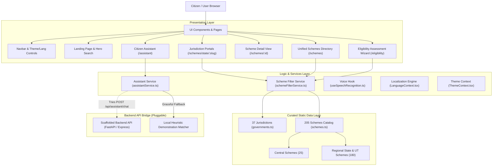

# CivicAI 🇮🇳 — Discover Government Welfare Schemes Across India

> **AI-Assisted, Citizen-Centric Public Service Intelligence Platform**  
> Covering the Central Government of India, all 28 States, and all 8 Union Territories with 205 verified welfare schemes.

[]()
[]()
[]()
[]()
[]()
[]()

---

## 📌 Problem Statement

Every year, the Government of India and State/UT Administrations allocate thousands of crores to welfare programs covering agriculture, healthcare, education, pensions, women empowerment, housing, and social security. 

However, eligible citizens face severe hurdles:
1. **Information Fragmentation:** Schemes are scattered across dozens of individual ministry websites and state portals with no single unified entry point.
2. **Language Barriers:** Official scheme guidelines are frequently published in complex administrative language or solely in English/Hindi.
3. **Complex Eligibility Criteria:** Determining whether a household qualifies requires cross-referencing multiple variables: age, caste/social category, income thresholds, land ownership, and occupation.
4. **Uncertain Official Sources:** Outdated blogs and predatory third-party websites often provide unverified application procedures or broken links.

---

## 💡 CivicAI Solution

**CivicAI** bridges the gap between citizens and public welfare by providing an intuitive, multilingual, verified digital directory and eligibility matching platform.

### Core Capabilities

- **Unified National Coverage:** Dedicated government portals for the **Central Government of India**, all **28 States**, and all **8 Union Territories** (37 distinct jurisdictions).
- **Curated & Verified Catalog:** 205 structured government welfare schemes with verified department names, official application URLs, and documented benefits.
- **Multilingual Accessibility:** Full localized interface in 4 Indian languages: **English**, **Hindi (हिन्दी)**, **Tamil (தமிழ்)**, and **Telugu (తెలుగు)**.
- **Multi-Step Eligibility Wizard:** A rule-based self-assessment tool evaluating age, occupation, income ceiling, cultivable land holding, BPL status, social category, and statutory government employee exclusions.
- **Voice-Enabled Citizen Search:** Speech-to-text input powered by the Web Speech API with regional accent support (en-IN, hi-IN, ta-IN, te-IN).
- **Intelligent Assistant & Demonstrator:** Natural language inquiry engine supporting intent detection across all 37 jurisdictions with transparent citation metadata.
- **Accessible & Responsive Design:** WCAG-conscious styling with high-contrast Light/Dark/System theme options, keyboard focus management, and smooth responsive layouts.

---

## 🧱 Technology Stack

| Layer | Technologies & Tools |
| :--- | :--- |
| **Frontend Framework** | [React 19](https://react.dev/) (`19.3.1`), [TypeScript](https://www.typescriptlang.org/) (`~7.0.2`) |
| **Routing** | [React Router DOM](https://reactrouter.com/) (`v7.18.5`) with canonical state/UT slug routes |
| **Styling & Design System** | [Tailwind CSS v4](https://tailwindcss.com/) (`^4.3.3`), `@tailwindcss/vite`, CSS Variables |
| **Icons & Visuals** | [Lucide React](https://lucide.dev/) (`^1.66.0`) |
| **Build & Dev Tooling** | [Vite 8](https://vite.dev/) (`8.3.5`), Rolldown bundler |
| **Linting & Code Quality** | [Oxlint](https://oxc.rs/) (`^1.89.0`) for high-speed AST linting |
| **Unit & Integration Testing** | [Vitest](https://vitest.dev/) (`^5.0.5`) |
| **End-to-End Verification** | Chrome DevTools Protocol (CDP) WebSocket headless automation |
| **Voice Interface** | Native Browser Web Speech API (`webkitSpeechRecognition`) |

---

## 🗺️ System Architecture

CivicAI operates on a robust, client-first single page application architecture designed for maximum performance, offline reliability, and low latency:



---

## 📊 Scheme Coverage Breakdown

The catalog contains **205 verified government schemes** structured across **37 administrative jurisdictions**:

| Jurisdiction Group | Entities Covered | Schemes per Entity | Total Schemes |
| :--- | :--- | :---: | :---: |
| **Central Government** | Union Government of India | 25 | **25** |
| **Southern States** | Andhra Pradesh, Telangana, Tamil Nadu, Karnataka, Kerala | 5 | **25** |
| **Northern States** | Uttar Pradesh, Rajasthan, Punjab, Haryana, Uttarakhand, Himachal Pradesh | 5 | **30** |
| **Western & Central States** | Maharashtra, Gujarat, Madhya Pradesh, Chhattisgarh, Goa | 5 | **25** |
| **Eastern States** | West Bengal, Bihar, Odisha, Jharkhand | 5 | **20** |
| **Northeastern States** | Assam, Arunachal Pradesh, Manipur, Meghalaya, Mizoram, Nagaland, Sikkim, Tripura | 5 | **40** |
| **Union Territories** | Delhi (NCT), Jammu & Kashmir, Ladakh, Puducherry, Chandigarh, Andaman & Nicobar, Dadra & Nagar Haveli and Daman & Diu, Lakshadweep | 5 | **40** |
| **Total Nationwide** | **37 Jurisdictions** | — | **205** |

---

## ⚡ Quickstart

### Prerequisites
- **Node.js**: v18.0.0 or higher (v20+ or v24 LTS recommended)
- **npm**: v9.0.0 or higher
- **Git**: Installed and configured

### Important Branch Note
The production-ready application code and all features reside on the **`feature/national-schemes-mission`** branch of [`https://github.com/Krishnacymk/civicai`](https://github.com/Krishnacymk/civicai). Make sure you checkout this branch after cloning:

```bash
git clone https://github.com/Krishnacymk/civicai.git
cd civicai
git checkout feature/national-schemes-mission
```

### Installation & Development Server

#### Windows Command Prompt (cmd.exe)
```cmd
cd frontend
npm install
npm run dev
```

#### Windows PowerShell
```powershell
Set-Location -Path frontend
npm install
npm run dev
```

#### Linux / macOS (bash / zsh)
```bash
cd frontend
npm install
npm run dev
```

Once started, open your browser and navigate to `http://localhost:5173`.

---

## 🧪 Testing & Code Quality

The repository includes a comprehensive testing and quality assurance suite:

```bash
# Run unit & data integrity tests (11/11 tests)
cd frontend
npm test

# Run high-speed static analysis linter
npm run lint

# Run type check and production build
npm run build

# Run end-to-end headless Chrome browser navigation suite (34/34 assertions)
cd ..
node scripts/verify_navigation_e2e.cjs
```

For detailed test reports and verification methodologies, see [Testing Guide](docs/TESTING.md).

---

## 📂 Repository Structure

```text
civicai/
├── backend/                       # Scaffolded backend service directory
│   └── app/                       # Structure for future API & RAG services
│       ├── api/
│       ├── data/
│       ├── models/
│       └── services/
├── docs/                          # Comprehensive project documentation
│   ├── ARCHITECTURE.md            # Detailed system design & data flow
│   ├── INSTALLATION.md            # Detailed local setup (Windows/Linux/macOS)
│   ├── API.md                     # Client-side service & network API contracts
│   ├── DEPLOYMENT_EC2.md          # AWS EC2 Ubuntu & Nginx deployment guide
│   ├── TESTING.md                 # Unit, Linting, Link Audit & E2E suite
│   ├── PROJECT_STATUS.md          # Implementation matrix & verified metrics
│   └── CONTRIBUTING.md           # Contribution guidelines & schema specs
├── frontend/                      # Client-side React 19 application
│   ├── public/                    # Static assets & SVG icons
│   ├── src/
│   │   ├── assets/                # Images & illustrations
│   │   ├── components/            # Reusable UI components
│   │   │   ├── common/            # Navbar, Footer, OfficialSourceBadge, etc.
│   │   │   └── schemes/           # GovernmentSectionNav, SchemeCard, etc.
│   │   ├── context/               # ThemeContext & LanguageContext providers
│   │   ├── data/                  # Static datasets
│   │   │   ├── governments.ts     # Metadata for 37 Indian jurisdictions
│   │   │   ├── schemes.ts         # Unified scheme catalog aggregator
│   │   │   └── schemes/           # Regional partitioned scheme definitions
│   │   ├── hooks/                 # Custom React hooks (useSpeechRecognition)
│   │   ├── i18n/                  # Localization (en, hi, ta, te dictionaries)
│   │   ├── pages/                 # Route views (Landing, Schemes, Detail, etc.)
│   │   ├── services/              # schemeFilterService, assistantService
│   │   └── types/                 # TypeScript interfaces (scheme, government)
│   ├── package.json
│   ├── tsconfig.json
│   └── vite.config.ts
├── scripts/                       # Verification, link auditing & E2E runners
│   ├── link_audit.cjs             # Live HTTP status auditor for official links
│   ├── link_audit_results.json    # Machine-readable external link report
│   └── verify_navigation_e2e.cjs  # Chrome CDP automated browser test suite
├── LINK_AUDIT_REPORT.md           # External URL health and bot-blocking report
└── README.md                      # Project overview and entry point
```

---

## 📸 Screenshots & Walkthrough Guidance

When showcasing or evaluating CivicAI, review these key screens:

1. **National Scheme Directory (`/schemes`):**
   - Displays the interactive government navigation tabs (`Featured Portals (8)`, `28 States (140)`, `8 Union Territories (40)`, `All 37 Portals (188)`).
   - Fast state code search matching abbreviations like `AP`, `TG`, `TN`, `KA`, `DL`, `MH`, and `UP`.
2. **Dedicated Jurisdiction Portals (`/schemes/state/karnataka`, `/schemes/central`, `/schemes/ut/delhi`):**
   - Breadcrumb navigation, state administrative profile, official portal badge, and curated schemes.
3. **Comprehensive Scheme Detail Page (`/schemes/pm-kisan`):**
   - Financial assistance breakdowns, eligibility criteria, exclusion rules, step-by-step application instructions, required documents checklist, and direct official source links.
4. **Interactive Eligibility Wizard (`/eligibility`):**
   - Step-by-step interactive questionnaire providing high/conditional/unlikely matching verdicts with transparent disqualification reasons.
5. **AI Citizen Assistant (`/assistant`):**
   - Conversational assistant with voice input capability, state intent recognition, and direct scheme citations.
6. **Appearance & Localization Controls:**
   - Header controls to switch between Light, Dark, and System default themes.
   - Dynamic locale switcher between English, Hindi, Tamil, and Telugu.

---

## ⚠️ Limitations & Future Scope

### Current Limitations
- **Client-Side Catalog Size:** The complete dataset of 205 schemes is bundled into the client bundle (~1.6MB minified JS). Code-splitting can optimize initial asset load.
- **Backend API Integration:** The backend architecture is scaffolded in `backend/app/`, but currently the assistant operates using an in-browser heuristic engine with transparent citations.
- **Web Speech API Support:** Speech recognition relies on the browser's native Web Speech API, which requires Google Chrome, Microsoft Edge, or a compatible Chromium engine.
- **External Government Server Firewalls:** Several state government web servers (e.g., `bihar.gov.in`, `ap.gov.in`) employ strict geographic bot-protection firewalls that restrict automated health pings even when accessible to regular citizens.

### Future Roadmap
- [ ] Connect production Python FastAPI / Node backend to power Retrieval-Augmented Generation (RAG) over official scheme PDF guidelines.
- [ ] Add WhatsApp and SMS chatbot bots using Twilio / Gupshup for low-connectivity citizen access.
- [ ] Implement DigiLocker OAuth integration for instant document eligibility verification.
- [ ] Expand localization to all 22 Eighth Schedule Indian languages (Bengali, Marathi, Gujarati, Kannada, Malayalam, Odia, Punjabi, etc.).

---

## 📄 License & Responsible Information Notice

CivicAI is an open-source civic technology initiative built for educational, research, and hackathon demonstration purposes.

> **Citizen Notice:** Government welfare policies, subsidy amounts, and eligibility thresholds are subject to periodic administrative updates. CivicAI provides direct links to authoritative government portals (`*.gov.in`, `*.nic.in`) on every scheme card; users should always verify final criteria on the official administering department website before applying.
