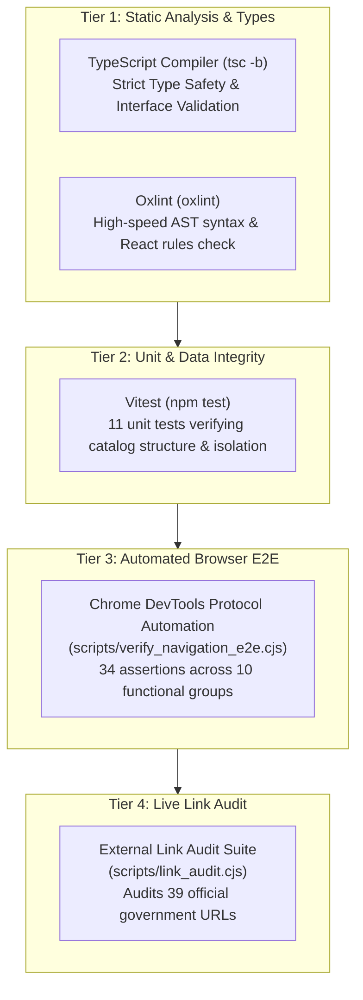

# CivicAI Testing & Verification Strategy

This document outlines the testing architecture, quality assurance procedures, and automated test runners implemented in CivicAI.

---

## 1. Testing Philosophy & Hierarchy

CivicAI employs a multi-tiered verification framework ensuring catalog accuracy, zero duplicate identifiers, strict jurisdictional isolation, type safety, and real browser end-to-end reliability.



---

## 2. Test Suites & Execution

### 2.1 Unit & Data Integrity Testing (Vitest)

Unit tests are located in [`frontend/src/services/__tests__/schemeFilterService.test.ts`](file:///D:/civicai/frontend/src/services/__tests__/schemeFilterService.test.ts).

#### Test Scope (11 Tests)
1. **Catalog Integrity:** Validates that `SCHEMES` contains exactly 205 items across 37 government entities with **zero duplicate IDs**.
2. **Central Government Classification:** Verifies that all 25 Central schemes have `governmentLevel === 'central'` and `stateCode === null`.
3. **28 States Coverage:** Validates that each of the 28 Indian States has exactly 5 curated schemes (total: 140 state schemes).
4. **8 Union Territories Coverage:** Validates that each of the 8 Union Territories has exactly 5 curated schemes (total: 40 UT schemes).
5. **Andhra Pradesh Strict Isolation:** Verifies AP schemes have `stateCode === 'AP'` and do not leak into other state queries.
6. **Telangana Strict Isolation:** Verifies TG schemes have `stateCode === 'TG'`.
7. **Tamil Nadu Strict Isolation:** Verifies TN schemes have `stateCode === 'TN'`.
8. **Polymorphic Slug Resolution:** Tests scheme lookup by slug (`'andhra-pradesh'`), id (`'gov-ap'`), or abbreviation (`'AP'`).
9. **National Central Availability:** Verifies Central schemes remain marked as Central when viewed from state contexts.
10. **Government Statistics Aggregation:** Verifies accuracy of calculated stats across all jurisdictions.
11. **Functional Category Filtering:** Tests scheme filtering by category within a specified government scope.

#### Run Command
```bash
cd frontend
npm test
```

#### Output
```text
 ✓ src/services/__tests__/schemeFilterService.test.ts (11 tests) 65ms

 Test Files  1 passed (1)
      Tests  11 passed (11)
```

---

### 2.2 Static Analysis & Linting (Oxlint)

CivicAI uses **Oxlint** for ultra-fast JavaScript and TypeScript code inspection.

#### Run Command
```bash
cd frontend
npm run lint
```

#### Output
```text
Found 2 warnings and 0 errors.
Finished in 103ms on 40 files with 116 rules using 8 threads.
```
*(The two warnings relate to React Fast Refresh export patterns in context providers).*

---

### 2.3 TypeScript Build & Type Check

Verifies full type safety with the TypeScript compiler before bundling production assets with Vite:

```bash
cd frontend
npm run build
```

---

### 2.4 Automated End-to-End Browser Testing (Chrome CDP)

The automated E2E test runner ([`scripts/verify_navigation_e2e.cjs`](file:///D:/civicai/scripts/verify_navigation_e2e.cjs)) spins up an instance of headless Google Chrome, attaches directly via the **Chrome DevTools Protocol (CDP)** WebSocket, and validates DOM rendering, user interactions, routing transitions, and console error logging.

#### 10 Test Groups (34 Total Assertions)

| Test Group | Validations Performed | Assertions | Result |
| :--- | :--- | :---: | :---: |
| **1. Primary Portal Navigation** | Clicks portal cards for Central, AP, TG, TN, KA, MH, UP, and Delhi; verifies canonical URLs and heading text | 8 | **PASS** |
| **2. Additional State & UT Clicks** | Tests state tab navigation for Gujarat and UT tab navigation for Puducherry | 2 | **PASS** |
| **3. Dynamic Tabs & Accurate Counts** | Verifies card counts across tabs: Featured (8), States (28), UTs (8), All (37) | 4 | **PASS** |
| **4. Search Box & Aliases** | Searches state codes (`AP`, `TG`, `KA`, `DL`), handles whitespace trimming, validates empty state, tests clear button | 7 | **PASS** |
| **5. View All Unified Schemes** | Validates navigation from jurisdiction view back to unified directory (`/schemes`) | 1 | **PASS** |
| **6. Direct URL Reloads** | Direct browser URL navigation and reload on `/schemes/central`, `/schemes/state/*`, `/schemes/ut/*` | 5 | **PASS** |
| **7. 404 / Not-Found Handling** | Tests unknown state route (`/schemes/state/atlantis`) and unknown scheme ID routes | 2 | **PASS** |
| **8. History Back/Forward** | Verifies browser `history.back()` and `history.forward()` preserve page state | 2 | **PASS** |
| **9. All 37 Jurisdiction Routes** | Iterates through and navigates to all 37 government portal routes in Chrome | 2 | **PASS** |
| **10. Browser Console Audit** | Asserts zero unhandled JavaScript exceptions or console errors during entire run | 1 | **PASS** |

#### Run Command
```bash
# Requires local dev server running on http://localhost:5173
node scripts/verify_navigation_e2e.cjs
```

#### Output
```text
=========================================
E2E SUITE RESULTS: 34 Passed | 0 Failed
=========================================
```

---

### 2.5 Live Official Source Link Audit

Located in [`scripts/link_audit.cjs`](file:///D:/civicai/scripts/link_audit.cjs). Audits external government source URLs defined in scheme records.

#### Run Command
```bash
node scripts/link_audit.cjs
```

#### Audit Summary
- **Total External URLs Audited:** 39
- **Confirmed Active (2xx/3xx):** 29 URLs
- **Confirmed 404 Broken:** 0 URLs
- **Inconclusive (Timeouts / Geo-blocking / SSL handshake):** 10 URLs  
  *(Government firewalls frequently drop non-browser automated HTTP clients while loading normally for citizens in browsers).*

Full results are recorded in [`LINK_AUDIT_REPORT.md`](file:///D:/civicai/LINK_AUDIT_REPORT.md) and [`scripts/link_audit_results.json`](file:///D:/civicai/scripts/link_audit_results.json).

---

## 3. Continuous Integration Checklist

Before committing code or preparing a release, run this standard verification pipeline:

```bash
# 1. Unit tests
cd frontend && npm test

# 2. Linter
npm run lint

# 3. TypeScript compilation & production build
npm run build

# 4. End-to-end browser verification (ensure dev server is running on :5173)
cd .. && node scripts/verify_navigation_e2e.cjs
```
